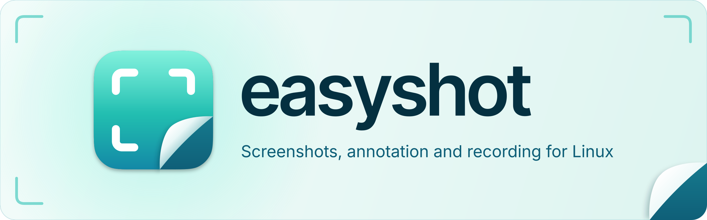

<h1 align="center">
  <picture>
    <source media="(prefers-color-scheme: dark)" srcset="assets/banner/banner-dark.svg">
    <source media="(prefers-color-scheme: light)" srcset="assets/banner/banner-light.svg">
    
  </picture>
</h1>

A screenshot, annotation and screen-recording app for Linux/Wayland, built with Rust and
GPUI. Capture an area, a window, text, a colour or a scrolling page, mark it up in a full
editor, and record your screen, all from key binds in your own compositor. It runs as one
background service with a tray icon and a floating preview of each capture.

Website and how-to guide: https://easyshot.site

## Features

**Capture**
- Area, window, full screen, previous area, timed (3, 5 or 10 seconds) and scrolling
  capture. The screen always freezes first.
- Text (OCR, needs Tesseract), QR codes and a colour picker.
- Screenshots can be pinned above other windows.

**Annotate**
- An editor with 12 tools, editable text, crop, rotate and flip, and undo.
- Background, camera angle, progressive blur, border, watermark and presets.
- Smart Redaction covers sensitive text it finds. Unsaved edits come back after a crash.

**Record**
- Area, display or window recording with system audio and microphone, through
  gpu-screen-recorder (preferred) or wf-recorder. A trim viewer opens when you stop.

**Desktop integration**
- A preview deck for every capture, a media gallery, settings, a first-run guide and a tray
  menu.
- A command line (`easyshot capture region`, `easyshot doctor`, ...) and `easyshot://`
  links, so any key bind or launcher can drive it.

`docs/MANUAL.md` describes each in full.

## Status and limits

easyshot runs end to end: the `easyshot daemon` service connects the capture overlays, the
deck, the editor, settings, gallery, tray, recording and the command line.

- **Hyprland:** installed and used for the first time on 2026-11-02 and 2026-11-03 (capture,
  editor, settings, tray). Bugs found there are fixed, and the fixed build has not been run
  on Hyprland again.
- **sway 1.12:** tested in a headless session and in headless GPUI windows only.
- **niri:** not run at all.
- Version 1 targets Hyprland 0.57+, sway 1.12 and niri 26.04. Other compositors with
  layer-shell and a capture protocol should work for basic capture. KDE and GNOME are not
  supported.
- Recording needs gpu-screen-recorder or wf-recorder. The screen-cast portal is not used.
- easyshot never edits your compositor config; you add the key binds yourself.
- There is no video studio (timeline, zooms, captions), camera recording, cloud sharing,
  built-in updater or Flatpak.

## Install

On Arch Linux, two packages are prepared in `packaging/aur/`: `easyshot` (builds the
release from its vendored source) and `easyshot-bin` (prebuilt). Neither is on the AUR yet.
From a checkout, this builds the package and installs it with pacman (it asks for sudo):

```
just install
```

The package enables and starts the user service `easyshot.service`. There are no packages
for other distributions.

To build from source, use the Rust 1.98.1 that `rust-toolchain.toml` pins:

```
cargo build --release -p easyshot
```

Maintainers cut releases with `just release`; see `packaging/README.md`.

## Quick start

Without the package, start the service yourself. D-Bus activation also starts it on your
first command.

```
systemctl --user enable --now easyshot.service
easyshot capture region
easyshot record
easyshot settings
easyshot doctor
```

`easyshot doctor` reports what your compositor and tools support. Settings > Shortcuts
shows ready-made bind lines for your compositor. By hand, for example:

```
# Hyprland, Lua config (hyprland.lua)
hl.bind("SUPER + SHIFT + 4", hl.dsp.exec_cmd("easyshot capture region"))

# Hyprland, hyprlang config (hyprland.conf)
bind = SUPER SHIFT, 4, exec, easyshot capture region

# sway (config)
bindsym Mod4+Shift+4 exec easyshot capture region

# niri (inside binds { } in config.kdl)
Mod+Shift+4 { spawn "easyshot" "capture" "region"; }
```

## Documentation

- `docs/MANUAL.md`: what you can do with it
- `docs/ARCHITECTURE.md`: how it is built and what has been run where
- `docs/DESIGN.md`: why it looks and behaves as it does
- `docs/DECISIONS.md`: each choice and what was rejected
- `docs/PRIOR-ART.md`: what it builds on
- `CONTRIBUTING.md`: how to work on it
- `CHANGELOG.md`: what changed in each release
- `packaging/README.md`: packages and releases

## Contributing

Read `CONTRIBUTING.md` and `CLAUDE.md` first. Tests never touch your live session. Run
`just` to list the tasks.

## Licence

MIT. Bundled fonts, icons and Rust dependencies keep their own terms; see `LICENSES/`
(`LICENSES/THIRD-PARTY.md` lists every linked crate). Source:
https://github.com/mah3uz/easyshot
